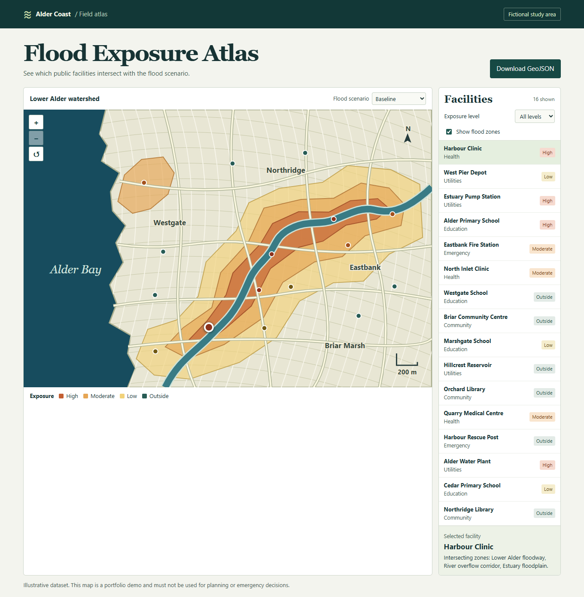
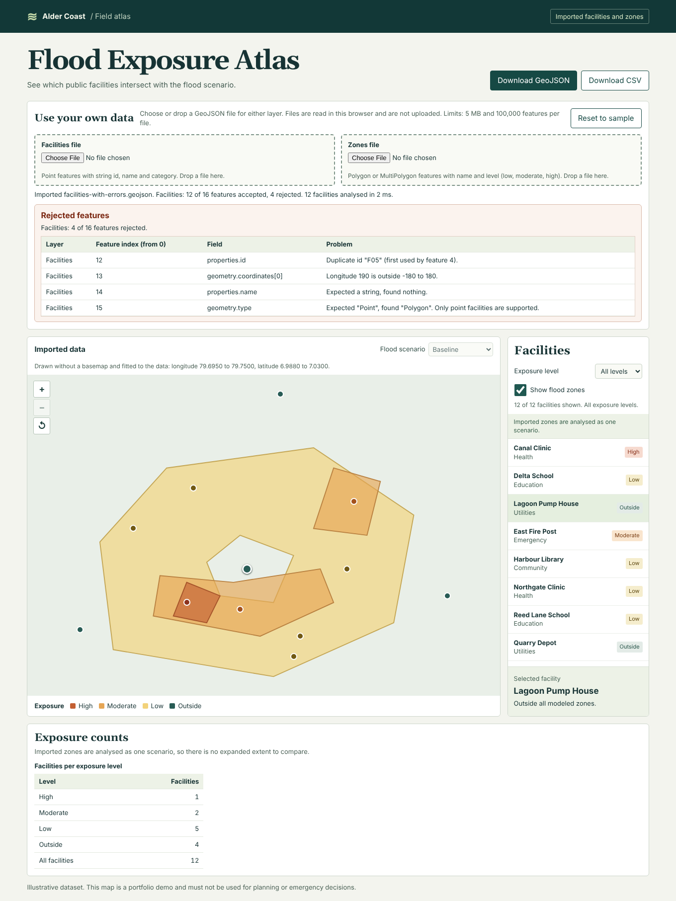

# Flood Exposure Atlas

[](https://github.com/muhammmmadziam1234-eng/flood-exposure-atlas/actions/workflows/test.yml)

A browser tool for one spatial question: which facility sits inside which flood zone, and at what level? It ships with a fictional coastal scenario, accepts your own GeoJSON files (checked first, then analysed in a Web Worker), compares two flood extents, and exports GeoJSON and CSV. There are no runtime dependencies and no build step, and the page loads nothing except its own files. The spatial engine was compared with Shapely on 760,667 polygon-point pairs and disagreed on none.



## What it demonstrates

- **A spatial join with written rules.** Boundary points are covered, hole interiors are not, overlapping zones resolve to the highest level. [`geo.mjs`](geo.mjs) states the rules and [`test/geo.property.test.mjs`](test/geo.property.test.mjs) checks them on seeded random scenes.
- **Independent verification.** [`validation/crosscheck.py`](validation/crosscheck.py) compares the engine with Shapely and writes [`docs/evidence/crosscheck.json`](docs/evidence/crosscheck.json). [`validation/mutants.py`](validation/mutants.py) breaks the engine on purpose to show that the check can fail.
- **Data import that explains itself.** [`validate.mjs`](validate.mjs) rejects bad features one by one with the feature index, the field and the reason, and refuses files over 5 MB or 100,000 features.
- **Work off the main thread.** Imported data is analysed in a module Web Worker ([`worker.mjs`](worker.mjs)) with progress and a Cancel button.
- **Measured performance, not claimed performance.** [`benchmark.mjs`](benchmark.mjs) writes [`docs/evidence/benchmark.json`](docs/evidence/benchmark.json), including the machine.
- **Accessibility that is tested.** axe-core, measured text contrast, control sizes, keyboard use and reduced motion are all checked in [`e2e/`](e2e).
- **Small, typed, dependency-free code.** JavaScript modules with JSDoc types checked by `tsc --strict`, a Content-Security-Policy that allows only same-origin files, and CI on Node 22 and 24.

## Run it

Node.js 22 or later. The app and the unit tests need no install.

~~~sh
npm start                                        # http://127.0.0.1:4173 (set PORT to change it)
npm test                                         # unit tests
npm run analyze -- exposure.geojson expanded     # batch export of the sample scenario
npm run benchmark                                # quick grid-versus-direct check
~~~

The checks below need `npm ci`, which installs only development tools (TypeScript, playwright-core, axe-core):

~~~sh
npm run typecheck                                # tsc --noEmit, strict, checkJs
npm run test:coverage                            # unit tests; fails under 90% of lines for geo.mjs and validate.mjs
CHROME_PATH=/usr/bin/google-chrome npm run e2e   # browser tests; any Chrome or Chromium executable works
                                                 # (WRITE_EVIDENCE=1 also rewrites docs/evidence/accessibility.json)
npm run benchmark -- --large                     # the recorded benchmark (rewrites docs/evidence/benchmark.json)
pip install -r validation/requirements.txt       # Python 3.12
python validation/crosscheck.py                  # rewrites docs/evidence/crosscheck.json
python validation/mutants.py
~~~

## Method

### Rules

The scenario stores facilities (points) and zones (polygons) as [WGS 84 GeoJSON](https://www.rfc-editor.org/info/rfc7946/). Each facility is tested against the zones with these rules, all in [`geo.mjs`](geo.mjs):

- The test is planar: longitude is x, latitude is y. There is no geodesic maths and no antimeridian handling.
- A point on a polygon boundary is covered: any vertex, and any point of an edge of the outer ring or of a hole.
- A point strictly inside a hole is not covered.
- A MultiPolygon covers a point when any one of its parts covers it.
- A facility's exposure is the highest level among the zones that cover it. Every covering zone is listed, highest level first, then by name (English collation, so the order does not depend on the machine's locale).
- "On an edge" means the cross product with the edge is under 1e-12 and the point lies inside the edge's bounding box. That is exact for integer coordinates. For other values it is a tolerance of about 1e-12 divided by the edge length, in degrees.
- A zone with an unknown level or no name stops the analysis with a clear error. A ring is treated as closed whether or not it repeats its first position.

For each ring the engine walks the edges once. A point on an edge is reported as on the boundary straight away; otherwise the crossings of a ray running to the right are counted (even-odd). A polygon covers the point when the outer ring reports the boundary, or reports inside and no hole reports inside.

### Grid index

A uniform grid of 0.006 degree cells (about 0.7 km north to south) maps each cell to the zones whose bounding box overlaps it. A lookup reads one cell and returns a shortlist; the exact test above makes the final decision. A zone whose bounding box spans more than 4096 cells, or is empty or not finite, is never gridded and stays on a separate list that is shortlisted for every point, so the grid can only return more candidates than needed, never fewer.

With N points, Z zones and v vertices per zone, a direct scan costs O(N x Z x v). The grid costs O(sum of cells covered by zones) to build, then for each point one cell lookup plus an exact test on the k shortlisted zones, O(N x k x v). The benchmark below reports k for a realistic scene.

### Why planar longitude and latitude is acceptable here, and when it is not

Point-in-polygon asks which side of each edge a point lies on. GeoJSON has no curved edges, and the engine treats the segment between two positions as a straight line in longitude and latitude. The cost of that choice is the gap between the straight line and the great-circle path between the same two positions. It is largest for east-west edges and grows with latitude and edge length ([`docs/evidence/planar-gap.txt`](docs/evidence/planar-gap.txt), from [`validation/planar-gap.mjs`](validation/planar-gap.mjs), spherical Earth): at 45 degrees latitude the two paths are 0.5 m apart for a 5 km edge and 196.2 m apart for a 100 km edge; at 60 degrees, 0.8 m and 339.8 m. So the planar model suits a study area of a few kilometres, such as the sample, and does not suit continental polygons, polygons that cross the antimeridian or enclose a pole, or work that needs distances or buffers. The Shapely cross-check below is planar as well, so it shows the rules are implemented correctly; it says nothing about how well a planar model fits the ground.

## Validation evidence

Numbers below are read from [`docs/evidence/crosscheck.json`](docs/evidence/crosscheck.json) (and `crosscheck-mutants.json` next to it).

| | |
| --- | --- |
| Reference | `shapely.covers(polygon, point)`: boundary covered, hole interiors not |
| Polygons | 1,800: 400 convex, 400 concave, 400 with holes, 300 multipolygons, 300 float polygons at longitude/latitude scale |
| Polygon-point pairs | 760,667 (229,744 covered, 46,117 exactly on a boundary, 3,345 strictly inside a hole) |
| Disagreements | 0, for each of the three engine paths: `contains`, `analyze` with its default grid, `zoneIndex` with a per-case cell size |
| Versions | Shapely 2.2.0, GEOS 3.14.1, NumPy 2.5.4, Python 3.12.3, Node v22.23.4 |
| Seed | 20261115 |

Integer-grid cases use points on a half-unit grid, so vertices, edge points and edge midpoints are exact boundary cases. Float cases keep every point at least 1e-7 degrees (about 1 cm) from a boundary, where the engine's edge tolerance does not apply; about half of those points are placed 1e-7 to 1e-4 degrees from an edge, which is the hard case for ray casting.

A clean result is only informative if the check can fail. `validation/mutants.py` changes a scratch copy of `geo.mjs` in six ways and runs the cross-check on a tenth of the cases: boundary points not covered, holes ignored, only the first part of a MultiPolygon tested, the edge test ignoring segment bounds, the grid dropping its last column of cells, and the edge tolerance widened to 1e-3. All six were caught. The cross-check found no fault in the engine, so it caused no engine change. The hardening listed in the rules came from reading the code; the tests for it failed on the old engine and pass now, and the old engine already passed the seeded invariant tests for valid input. On the sample scenario and 400 random valid scenes the old and the hardened engine gave identical output.

The unit tests add checks that need no Python: agreement with an exact winding-number oracle on integer polygons, vertices and edge lattice points always covered, a point moved into a hole becoming outside, raising a zone's level never lowering any exposure, and grid results equal to a direct scan on random scenes with broad zones and points on cell edges.

## Performance evidence

[`docs/evidence/benchmark.json`](docs/evidence/benchmark.json), measured on Intel(R) Xeon(R) Processor @ 2.30GHz (4 logical cores), Node v22.23.4. These numbers describe that machine on that day, not a promise.

- Scene: 100,000 points and 2,000 irregular polygons (0.2 to 1.3 km across, scattered over a 0.5 degree square); 14,974 points fall inside at least one zone.
- Grid, all points: median 157 ms over 5 runs, about 636,960 points per second. That includes building the grid (3.8 ms) and creating the result objects.
- The grid shortlisted a mean of 1.08 zones per point (at most 6), against 2,000 for a direct scan.
- Direct scan on a 2,000-point subset: median 1041.7 ms, against 5.4 ms for the grid on the same subset, with identical results (191.3 times). The direct scan was not run on all 100,000 points and nothing is extrapolated.

`npm run benchmark` without `--large` runs a smaller comparison (6,000 points, 1,000 polygons) and does not write evidence. The page itself was not benchmarked; a browser test loads 20,000 facilities, and the page draws at most 200 list rows and 1,000 map markers (plus the selected facility if it is further down), while counts and exports cover every facility.

## Import your own data

Use the two pickers under "Use your own data", or drop a file on either one. Each layer can be replaced on its own. Files are read in the browser and are never uploaded: the Content-Security-Policy in [`index.html`](index.html) allows only same-origin scripts, styles, fonts and workers and blocks `fetch` and every other outgoing connection (`default-src 'none'`), and the browser tests check that every request stays on the page's own origin. Imported data is not stored; reloading returns to the sample. Try it with the files in [`sample/`](sample): load `zones.geojson`, then `facilities-with-errors.geojson` to see rejected features listed.



A minimal facilities file. Each feature is a Point with string `id` (unique), `name` and `category`. A third coordinate (altitude) is accepted and dropped; other properties are dropped.

~~~json
{
  "type": "FeatureCollection",
  "features": [
    {
      "type": "Feature",
      "geometry": { "type": "Point", "coordinates": [79.711, 6.999] },
      "properties": { "id": "F01", "name": "Canal Clinic", "category": "Health" }
    }
  ]
}
~~~

A minimal zones file. Each feature is a Polygon or MultiPolygon with `name` and `level` (`low`, `moderate` or `high`, lower case).

~~~json
{
  "type": "FeatureCollection",
  "features": [
    {
      "type": "Feature",
      "geometry": {
        "type": "Polygon",
        "coordinates": [[[79.70, 6.99], [79.74, 6.99], [79.74, 7.02], [79.70, 7.02], [79.70, 6.99]]]
      },
      "properties": { "name": "Delta floodplain", "level": "low" }
    }
  ]
}
~~~

What is checked, per feature (the unit tests in [`test/validate.test.mjs`](test/validate.test.mjs) cover every message):

- Coordinates are finite numbers with longitude -180 to 180 and latitude -90 to 90. Polygon rings are closed, have at least 4 positions and a non-zero area, and do not jump more than 180 degrees of longitude between neighbouring positions (that would cross the antimeridian, which is not supported).
- Text fields are strings of 1 to 200 characters after trimming. A repeated facility id is rejected; the first accepted one wins.
- Limits: 5 MB and 100,000 features per file. A file over a limit, not valid JSON, or not a FeatureCollection is refused whole, with one message.
- A bad feature is rejected and the good ones are kept. If a layer has no acceptable feature at all, nothing is imported and the data on screen stays. Up to 1,000 problems are listed per layer; the page says how many more there were.

Imported zones are analysed as one scenario, so the scenario switch and the comparison table apply only while the sample zones are in use. Imported data is drawn without a basemap, fitted to its extent (longitude scaled by the cosine of the middle latitude, for drawing only; analysis always uses longitude and latitude).

### Outputs and links

- **Download GeoJSON** and **Download CSV** export the facilities currently shown (the scenario and level filter apply). CSV columns: `id, name, category, lon, lat, exposure, baseline_exposure, change, matched_zones`, with CRLF line ends and RFC 4180 quoting. Text that begins with `=`, `+`, `-`, `@`, a tab or a carriage return gets a leading apostrophe so a spreadsheet shows it as text instead of running it as a formula; numbers are untouched.
- **Scenario comparison** shows facilities per level for both scenarios and the facilities that change, with a signed change. The sample's expanded zones are the baseline polygons scaled about their own centres, so a facility can also drop a level.
- **URL state**: `#scenario=expanded&level=high&site=S04` is restored on load and kept current without adding history entries or moving the page. Anything it cannot understand falls back to the default.

## Architecture

```mermaid
flowchart LR
  files[(GeoJSON files)] --> app
  subgraph page [Main thread]
    app[app.mjs: map, list, tables, controls]
    sample[scenario.mjs: sample data]
    codec[codec.mjs: CSV, GeoJSON, URL hash]
    view[view.mjs: map fitting, SVG paths]
  end
  subgraph worker [Web Worker]
    w[worker.mjs] --> job[job.mjs]
    job --> validate[validate.mjs]
  end
  geo[geo.mjs: point-in-polygon, grid index, compare]
  app -- file text --> w
  w -- progress, problems, results --> app
  job --> geo
  sample --> app
  app --> geo
  app --> codec
  app --> view
  cli[analyze.mjs: batch export] --> geo
  cross[validation/crosscheck.py with Shapely] -. classify.mjs .-> geo
```

| File | Role |
| --- | --- |
| `geo.mjs` | The engine: `contains`, `zoneIndex`, `analyze`, `compare`, `withChange`, and the JSDoc types |
| `validate.mjs` | Import checks and limits |
| `job.mjs`, `worker.mjs` | One import job (validate, analyse, report progress) and the worker that hosts it |
| `app.mjs`, `index.html`, `style.css` | The page |
| `codec.mjs`, `view.mjs` | CSV and GeoJSON text, URL hash, map fitting |
| `scenario.mjs` | The fictional coast, its facilities and its zones |
| `serve.mjs` | A static file server for local use (fixed list of files, GET and HEAD only) |
| `validation/` | Shapely cross-check and mutation check |
| `test/`, `e2e/` | Unit tests and browser tests |

The page works from a sub-path (it is served as static files with relative paths, for example from GitHub Pages) and loads no font, tile or script from elsewhere. Headings use Georgia where it is installed and the bundled Gelasio, an open typeface with Georgia's letter widths, everywhere else.

## Accessibility

Checked by [`e2e/a11y.test.mjs`](e2e/a11y.test.mjs) and recorded in [`docs/evidence/accessibility.json`](docs/evidence/accessibility.json):

- axe-core 4.14.0 reports no violation (all default rules, including best practices) on the default view, the expanded scenario with a filter and a selected facility, and the rejected-features panel at 1280 px wide, and on the default view and the rejected-features panel at 360 px wide.
- Text contrast is measured on the live page: 97 text items, the lowest ratio is 5.73:1 (the minimum asked is 4.5:1). Map labels are measured against their halo or the sea colour.
- Every control, 55 measured per width, is at least 24 by 24 CSS pixels at 1280 px and at 360 px.
- Map markers are real buttons with a 24 px target, named "name, category, level". The facility list and the markers are each one tab stop (roving tabindex); arrow keys, Home and End move within them, Enter and Space select. One CSS rule gives every focusable element a visible focus ring, and map markers get a two-colour ring so it shows on both land and sea; the tests check the rings on list rows and markers.
- A polite live region states the filter result ("3 of 16 facilities shown. High exposure, expanded extent."), and the selected facility's detail is announced when it changes.
- With `prefers-reduced-motion: reduce` no transition or animation runs (the only transition is a short background fade on the drop areas, and only when motion is allowed).
- The browser tests also check that no page needs sideways scrolling at 360 px wide, including with the rejected-features panel open. The panel's table scrolls inside its own keyboard-focusable region.

axe-core lists two rules as "needs review" rather than failing: `color-contrast` (items whose background it cannot resolve: the decorative logo glyph, map labels drawn on SVG, and text it considers overlapped by the map) and `label-content-name-mismatch` (the three symbol-only zoom buttons "+", "−" and "↺", named "Zoom in", "Zoom out" and "Reset map view"). Everything else here was checked by tests, not by a person using a screen reader.

## Tests and CI

| Check | Command | Result when this README was written |
| --- | --- | --- |
| Unit tests (engine, property tests, validation, codecs, job, server, examples, evidence) | `npm test` | 49 pass |
| Line coverage gate, `geo.mjs` and `validate.mjs` | `npm run test:coverage` | 100% of lines for both, on Node 22 and 24; table in [`docs/evidence/coverage.txt`](docs/evidence/coverage.txt) |
| Types | `npm run typecheck` | no errors (TypeScript 7.0.2, strict, `checkJs`) |
| Browser tests (functional and accessibility) | `npm run e2e` | 20 pass, in Chromium |
| Shapely cross-check and mutation check | `python validation/crosscheck.py`, `python validation/mutants.py` | 0 disagreements; 6 of 6 mutants caught |

[`.github/workflows/test.yml`](.github/workflows/test.yml) (workflow name `Tests`) has three jobs: `unit` (Node 22 and 24: `npm ci`, typecheck, coverage gate, quick benchmark, `npm audit --omit=dev`), `e2e` (browser tests with the Chrome preinstalled on the runner) and `crosscheck` (Python 3.12, pinned Shapely and NumPy; fails on any disagreement or fewer than 200,000 pairs, and on a surviving mutant). Evidence files are regenerated locally and committed, not rewritten by CI, because tool versions differ between machines.

## Limits and next steps

- The model is planar longitude/latitude (see above). No reprojection: files must be WGS 84 longitude and latitude as GeoJSON requires, and any `crs` member is ignored.
- Self-intersecting rings and holes that are not inside their outer ring are not detected; the engine then follows its even-odd rules. Use a geometry-validity tool first. If your facilities need cleaning, the companion repository [geojson-quality-kit](https://github.com/muhammmmadziam1234-eng/geojson-quality-kit) standardises identifiers and labels, checks coordinate bounds and reports every rejected record for point inventories; this atlas validates but does not repair.
- Facilities must be points. Altitude is ignored. Antimeridian-crossing zones are rejected, not split.
- Imported zones are one scenario; comparing two imported zone files is not built.
- The map draws at most 3,000 zones, 1,000 markers and 200 list rows; counts, comparison and exports cover everything analysed. Imported data has no basemap.
- Tested in Chromium only (Chrome for Testing 153 here; the workflow uses the runner's Chrome). Firefox and Safari were not tested, and no real screen reader was used.
- The benchmark is one machine and one scene shape. Page rendering time with very large files was not measured.
- Next steps if this became a product: a second imported scenario with a diff, a validity check for self-intersections, a downloadable rejection report, and split handling for the antimeridian.

This is fictional sample data, not a flood forecast or a real-world risk assessment. The app has no map tile dependencies or external services.

## Publish the demo

The static files at the repository root can be served by GitHub Pages. In repository Settings → Pages, choose the main branch and the root folder as the source.

© 2026 muhammmmadziam1234-eng. All rights reserved, except the typeface in [fonts](fonts), which keeps its own licence.
